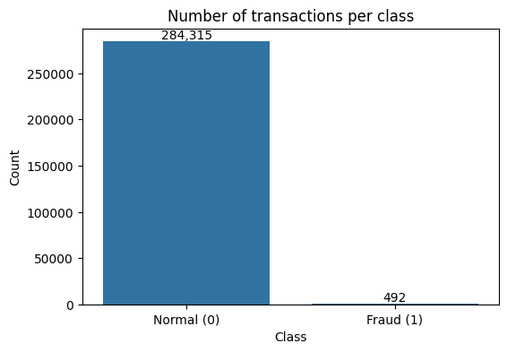
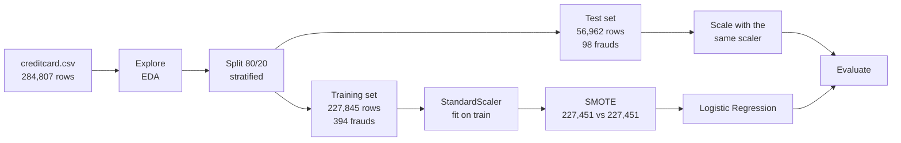
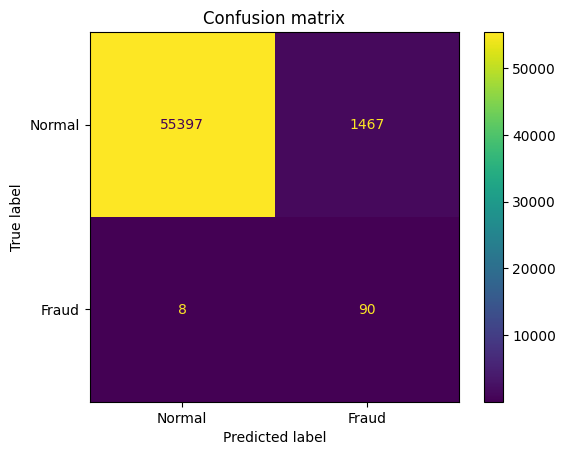
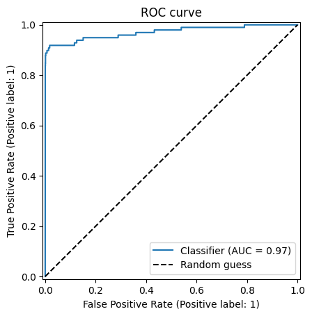

[README(5).md](https://github.com/user-attachments/files/33544200/README.5.md)
# Credit Card Fraud Detection

**Detecting credit card fraud with logistic regression and SMOTE.**

The model looks at a credit card transaction and estimates the probability that it is fraud. It catches **90 of the 98 frauds** in the test set (recall 92%) and separates fraud from normal transactions with a **ROC AUC of 0.97**. The project also includes a **data governance** notebook that documents the data, checks its quality and records a model card.

| Notebook | What it does |
|----------|--------------|
| [`Gold-Credit Card Fraud Detection.ipynb`](Gold-Credit%20Card%20Fraud%20Detection.ipynb) | **Final notebook:** loads the data, explores it, trains and evaluates the model, with results explained at every step |
| [`data_governance.ipynb`](data_governance.ipynb) | Feature register, data quality checks, split checks and model card |
| [`Silver-Credit Card Fraud Detection.ipynb`](Silver-Credit%20Card%20Fraud%20Detection.ipynb) | Intermediate version: full pipeline with a documented introduction |
| [`Bronze-Credit Card Fraud Analysis.ipynb`](Bronze-Credit%20Card%20Fraud%20Analysis.ipynb) | First version: the full pipeline in a single cell |

---

## Table of contents

1. [The problem](#1-the-problem)
2. [The data](#2-the-data)
3. [Pipeline overview](#3-pipeline-overview)
4. [Methods explained](#4-methods-explained)
5. [Results](#5-results)
6. [Data governance](#6-data-governance)
7. [Limitations and next steps](#7-limitations-and-next-steps)
8. [How to run](#8-how-to-run)
9. [Repository structure](#9-repository-structure)

---

## 1. The problem

Card fraud is rare but costly. A bank wants to flag suspicious transactions so an analyst can check them before money is lost. Two kinds of mistakes are possible:

- **Missed fraud** (false negative): the fraud goes through and the money is lost.
- **False alarm** (false positive): a normal transaction is flagged, an analyst spends time on it and the customer may be bothered.

Missing a fraud is usually far more expensive than a false alarm. For this reason the most important metric in this project is **recall**: the share of real frauds the model catches.

---

## 2. The data

**Dataset:** [Credit Card Fraud Detection](https://www.kaggle.com/datasets/mlg-ulb/creditcardfraud) on Kaggle (`creditcard.csv`), published by Worldline and the Machine Learning Group of ULB.

- **284,807 transactions** made by European cardholders over **two days**.
- **31 columns**, one row per transaction:

| Column | Meaning |
|--------|---------|
| `Time` | Seconds elapsed since the first transaction in the dataset |
| `V1`–`V28` | Anonymised features. The original transaction details were transformed with PCA (principal component analysis) to protect customer privacy, so their meaning is unknown |
| `Amount` | Transaction amount (EUR) |
| `Class` | **The answer:** 1 = fraud, 0 = normal |

The dataset is **not included** in this repository. The notebooks download it automatically from Kaggle with `kagglehub`.

### The key challenge: extreme imbalance



Only **492 of 284,807 transactions are fraud (0.17%)**. The fraud bar is almost invisible.

This has an important consequence. A "model" that always answers *normal* would be **99.83% accurate** and still catch **zero frauds**. Accuracy is therefore misleading here, and the project relies on recall, precision, F1 and ROC AUC instead.

---

## 3. Pipeline overview



The test set is put aside at the start and only used at the end. Scaling and SMOTE learn **only from the training set**, so the final evaluation reflects how the model would behave on new, real data.

---

## 4. Methods explained

### 4.1 Train/test split

The data is divided into:

- a **training set** (80%), which the model learns from;
- a **test set** (20%), which is hidden until the end and used to check the model on transactions it has never seen.

With `stratify=y`, both sets keep the same share of fraud: 0.173% in training and 0.172% in test. Without stratification, a random split could put too few frauds in the test set to measure anything reliably.

### 4.2 Feature scaling (StandardScaler)

The features have very different scales. `Time` goes up to about 172,800 and `Amount` up to over 25,000, while `V1`–`V28` are centred around 0. Logistic regression is sensitive to scale, so large numbers would dominate just because they are large.

`StandardScaler` transforms every feature so it has **mean 0 and standard deviation 1**:

```
scaled value = (value − mean) / standard deviation
```

The mean and standard deviation are computed on the **training set only** and then applied to the test set. Computing them on all the data would leak information from the test set into training.

### 4.3 SMOTE: balancing the classes

With only 394 frauds against 227,451 normal transactions in the training set, the model would mostly learn what *normal* looks like and largely ignore fraud.

**SMOTE** (Synthetic Minority Over-sampling Technique, from the `imbalanced-learn` library) creates **new, synthetic fraud examples** instead of simply copying the existing ones:

1. Take a real fraud transaction.
2. Find its 5 nearest fraud neighbours (the most similar frauds).
3. Pick one of them at random.
4. Create a new transaction at a random point on the line between the two.

Repeating this gives the model many realistic variations of fraud to learn from.

| Training set | Normal | Fraud |
|--------------|-------:|------:|
| Before SMOTE | 227,451 | 394 |
| After SMOTE  | 227,451 | 227,451 |

SMOTE created **227,057 synthetic frauds**. It is applied **only to the training set**. If it were applied to the test set, the model would be evaluated partly on artificial data and the results would look better than they really are.

### 4.4 The model: logistic regression

Logistic regression is one of the simplest and most widely used classification models. It works in three steps:

**1. Weighted score.** Each feature gets a weight learned from the data, and the model adds them up:

```
z = b + w1·Time + w2·V1 + ... + w30·Amount
```

A positive weight means the feature pushes towards fraud; a negative weight pushes towards normal.

**2. Probability.** The score is passed through the **sigmoid function**, which turns any number into a value between 0 and 1:

```
probability of fraud = 1 / (1 + e^(−z))
```

A very negative score gives a probability close to 0, and a very positive score gives a probability close to 1.

**3. Decision.** If the probability is **0.5 or higher**, the transaction is flagged as fraud; otherwise it is considered normal.

During training, the model adjusts the weights so the predicted probabilities match the real labels as closely as possible. Settings used: `max_iter=1000` (more iterations so the optimiser finishes), with all other settings at their defaults (L2 regularisation, `C=1.0`, `lbfgs` solver).

**Why logistic regression?** It is fast, simple and interpretable: each feature has one weight, and the output is a probability rather than just a yes/no. That makes it a good baseline before trying more complex models.

### 4.5 Evaluation metrics

All metrics are computed on the untouched test set. They are based on four counts:

| | Predicted normal | Predicted fraud |
|---|---|---|
| **Really normal** | True negative (TN) | False positive (FP): *false alarm* |
| **Really fraud**  | False negative (FN): *missed fraud* | True positive (TP): *fraud caught* |

| Metric | Formula | Question it answers |
|--------|---------|---------------------|
| **Accuracy** | (TP + TN) / all | What share of all predictions was correct? |
| **Precision** | TP / (TP + FP) | Of the transactions flagged as fraud, how many really were fraud? |
| **Recall** | TP / (TP + FN) | Of all the real frauds, how many did the model catch? |
| **F1** | 2·TP / (2·TP + FP + FN) | A single score balancing precision and recall |
| **ROC AUC** | Area under the ROC curve | How well does the model rank frauds above normal transactions, across all thresholds? 1.0 is perfect, 0.5 is random guessing |

---

## 5. Results

### Metrics on the test set

| Metric    | Value  |
|-----------|-------:|
| Accuracy  | 0.9741 |
| Precision | 0.0578 |
| Recall    | **0.9184** |
| F1        | 0.1088 |
| ROC AUC   | **0.9708** |

### Confusion matrix



| | Predicted normal | Predicted fraud |
|---|---:|---:|
| **Really normal** (56,864) | 55,397 | 1,467 |
| **Really fraud** (98)      | 8      | 90    |

### ROC curve



The ROC curve shows the trade-off between catching frauds (true positive rate, vertical axis) and raising false alarms (false positive rate, horizontal axis) for every possible decision threshold. The model's curve rises almost straight to the top-left corner, far above the dashed line of random guessing. This gives an **AUC of 0.97**.

### What the results mean

- **Frauds caught:** 90 of the 98 real frauds in the test set (**recall 92%**). Only **8** frauds were missed.
- **False alarms:** 1,467 normal transactions were flagged as fraud. That is only 2.6% of all normal transactions, but because fraud is so rare, false alarms far outnumber real frauds among the alerts. Of 1,557 alerts, only 90 were real (**precision 5.8%**), which is about **1 real fraud every 17 alerts**.
- **Accuracy (97.4%)** looks high but is actually *lower* than the 99.83% of a model that always says "normal". This confirms that accuracy is the wrong metric for this problem.
- **F1 (0.11)** is low because it combines high recall with very low precision.
- **ROC AUC (0.97)** shows that the model ranks fraudulent transactions above normal ones very well. Precision could therefore be improved by moving the decision threshold, without changing the model.

**In short:** the model is a good **first filter**. It finds most frauds, but its alerts still need to be reviewed by a person before acting on them.

---

## 6. Data governance

The [`data_governance.ipynb`](data_governance.ipynb) notebook documents and checks the data used by the model. It runs in Python only.

| Section | Content |
|---------|---------|
| **Dataset overview** | Source, provider, size, period covered, privacy classification, owner and steward |
| **Feature register** | 33 features (the 31 dataset columns plus the 2 model outputs) with business meaning, sensitivity, GDPR flag, critical data element flag and quality rule, plus a live profile of each column (type, nulls, min, max) |
| **Data quality checks** | 8 checks for completeness, validity, consistency, uniqueness and volume, each with a PASS/FAIL result. *Critical* failures block model training |
| **Split checks** | Rebuilds the train/test split and verifies its size, the stratification and that no row appears in both sets |
| **Model card** | Purpose, data, method, results, intended use, limitations, regulatory notes and approval status, plus a check that the reported metrics match the confusion matrix |

**Critical data elements:** `Amount`, `Class`, `fraud_probability` and `fraud_prediction`.

**Privacy:** the dataset contains no direct personal identifiers, and `V1`–`V28` are anonymised. Because the model output could affect customers, it is meant only as a first filter with human review (GDPR Art. 22).

---

## 7. Limitations and next steps

**Limitations**

- **Low precision:** about 94% of alerts are false alarms, which costs analyst time.
- **Old and short data:** two days of 2013 transactions. Fraud patterns change over time, so the model would need to be retrained on recent data.
- **Limited explainability:** `V1`–`V28` are anonymised, so the model's weights cannot be explained in business terms.
- **Default threshold:** the 0.5 threshold was not tuned to the real cost of missed frauds and false alarms.

**Next steps**

- **Tune the decision threshold:** raising it would reduce false alarms at the cost of missing a few more frauds. The high AUC suggests there is room to do this.
- **Try other models**, such as Random Forest or XGBoost, which often reach much higher precision on this dataset.
- **Compare SMOTE with `class_weight="balanced"`**, which gives fraud more weight without creating synthetic data.
- **Use the precision-recall curve and PR AUC**, which are more informative than ROC when the positive class is this rare.

---

## 8. How to run

```bash
pip install -r requirements.txt
```

Then open the notebooks and run all cells from top to bottom:

- **Databricks:** Workspace → ⋮ → Import, select the `.ipynb` file, then **Run all**.
- **Jupyter / Google Colab:** open the `.ipynb` file and run all cells.

The first cell installs the missing libraries, and the dataset is downloaded automatically from Kaggle.

**Libraries:** `pandas`, `matplotlib`, `seaborn`, `scikit-learn`, `imbalanced-learn`, `kagglehub`.

---

## 9. Repository structure

```
credit-card-fraud-detection/
├── Gold-Credit Card Fraud Detection.ipynb     # Final notebook: EDA, training and evaluation
├── Silver-Credit Card Fraud Detection.ipynb   # Intermediate version
├── Bronze-Credit Card Fraud Analysis.ipynb    # First version
├── data_governance.ipynb                      # Feature register, DQ checks, model card
├── requirements.txt                           # Python libraries
├── README.md                                  # This file
└── Images/
    ├── class_chart.png                        # Fraud vs normal counts
    ├── confusion_matrix.png                   # Confusion matrix on the test set
    └── roc_curve.png                          # ROC curve on the test set
```
